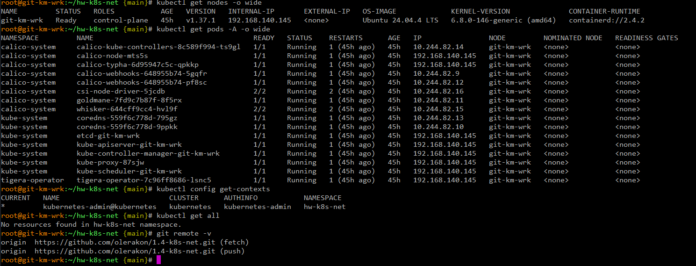
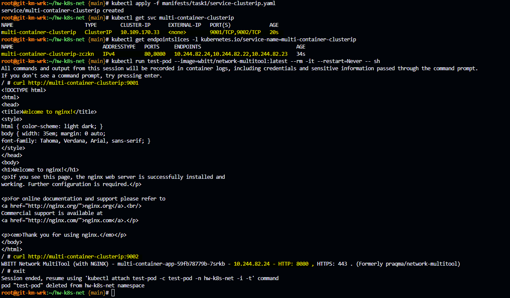
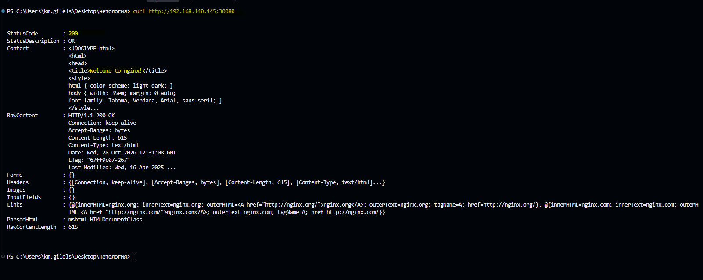
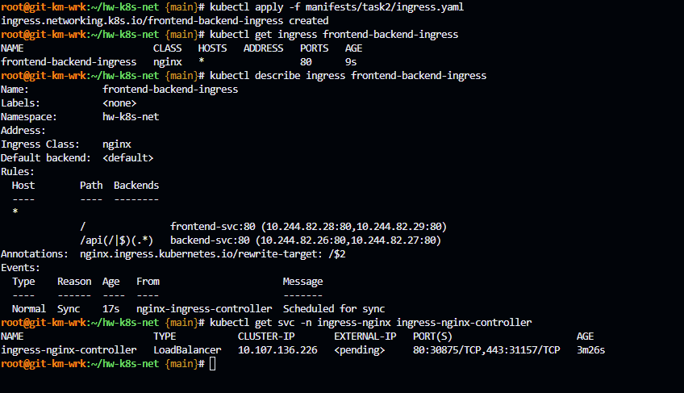
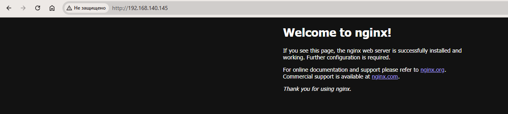
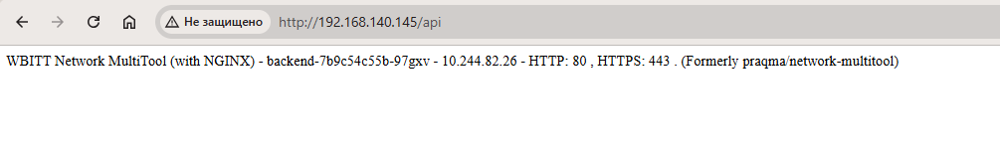
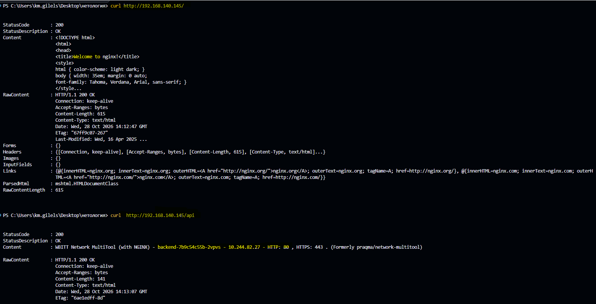

# Домашнее задание к занятию «Сетевое взаимодействие в Kubernetes» - `Гилельс Кирилл`

## Предварительная информация

На VM Ubuntu 24.04 LTS был развернут полноценный kubernetes версии 1.37.1 в формате all-in-one-single-node средствами kubeadm.

IP адресс машины 192.168.140.145

В качестве сетевого плагина был выбран calico. Network cidr: 10.244.0.0/16

Так же был инициализирован гит [репозиторий](https://github.com/olerakon/1.4-k8s-net) проекта 

Для домашнего задания был создан отдельный ns: `hw-k8s-net` и настроена дефолтная работа в нем через kubectl.

Сводная информация представлена на скриншоте:



Примечание: было желание выполнять блок по домашнему заданию на мощностях тестового кластера из 6 нод под управлением ранчера, внутри компании, однако в виду сетевых ограничений, осложнений в ввиде проксирования образов через нексус, развернутых тестовых сред с занятыми портами, пришлось делать отдельную сингл ноду *грусть-печаль-тоска-беда*

------

## **Задание 1: Настройка Service (ClusterIP и NodePort)**
### **Задача**
Развернуть приложение из двух контейнеров (`nginx` и `multitool`) и обеспечить доступ к ним:
- Внутри кластера через **ClusterIP**.
- Снаружи через **NodePort**.

### **Шаги выполнения**
1. **Создать Deployment** с двумя контейнерами:
   - `nginx` (порт `80`).
   - `multitool` (порт `8080`).
   - Количество реплик: `3`.
2. **Создать Service типа ClusterIP**, который:
   - Открывает `nginx` на порту `9001`.
   - Открывает `multitool` на порту `9002`.
3. **Проверить доступность** изнутри кластера:
```bash
 kubectl run test-pod --image=wbitt/network-multitool --rm -it -- sh
 curl <service-name>:9001 # Проверить nginx
 curl <service-name>:9002 # Проверить multitool
```
4. **Создать Service типа NodePort** для доступа к `nginx` снаружи.
5. **Проверить доступ** с локального компьютера:
```bash
 curl <node-ip>:<node-port>
   ```
 или через браузер.

### **Что сдать на проверку**
- Манифесты:
  - `deployment-multi-container.yaml`
  - `service-clusterip.yaml`
  - `service-nodeport.yaml`
- Скриншоты проверки доступа (`curl` или браузер).

------

### Решение

Multitool по умолчанию использует порт 80, поэтому задаём HTTP_PORT=8080, как требует задание.

1. Создал [Deployment](./manifests/task1/deployment-multi-container.yaml) с двумя контейнерами:
   - `nginx` (порт `80`).
   - `multitool` (порт `8080`).
   - Количество реплик: `3`.
2. Создал [Service типа ClusterIP](./manifests/task1/service-clusterip.yaml), который:
   - Открывает `nginx` на порту `9001`.
   - Открывает `multitool` на порту `9002`.
3. Проверил доступность изнутри кластера.



4. Создал [Service типа NodePort](./manifests/task1/service-nodeport.yaml) для доступа к nginx снаружи.
5. Проверил доступность с локального компьютера.



------

---
## **Задание 2: Настройка Ingress**
### **Задача**
Развернуть два приложения (`frontend` и `backend`) и обеспечить доступ к ним через **Ingress** по разным путям.

### **Шаги выполнения**
1. **Развернуть два Deployment**:
   - `frontend` (образ `nginx`).
   - `backend` (образ `wbitt/network-multitool`).
2. **Создать Service** для каждого приложения.
3. **Включить Ingress-контроллер**:
```bash
 microk8s enable ingress
   ```
4. **Создать Ingress**, который:
   - Открывает `frontend` по пути `/`.
   - Открывает `backend` по пути `/api`.
5. **Проверить доступность**:
```bash
 curl <host>/
 curl <host>/api
   ```
 или через браузер.

### **Что сдать на проверку**
- Манифесты:
  - `deployment-frontend.yaml`
  - `deployment-backend.yaml`
  - `service-frontend.yaml`
  - `service-backend.yaml`
  - `ingress.yaml`
- Скриншоты проверки доступа (`curl` или браузер).

------

### Решение

1. Развернул два Deployment:
   - [frontend](./manifests/task2/deployment-frontend.yaml) - (образ `nginx`).
   - [backend](./manifests/task2/deployment-backend.yaml) (образ `wbitt/network-multitool`).
2. Создал [Service-frontend](./manifests/task2/service-frontend.yaml) и [Service-backend](./manifests/task2/service-backend.yaml) для каждого приложения.
3. Развернул ингресс контроллер `kubectl apply -f https://raw.githubusercontent.com/kubernetes/ingress-nginx/controller-v1.15.1/deploy/static/provider/cloud/deploy.yaml`
Для функционирования по условию задания необходимо привести контроллер в режим HostNetwork=true
```bash
kubectl patch deployment ingress-nginx-controller \
  -n ingress-nginx \
  --type=strategic \
  -p '
spec:
  template:
    spec:
      hostNetwork: true
      dnsPolicy: ClusterFirstWithHostNet
'
```
4. Создать [Ingress](./manifests/task2/ingress.yaml), который:
   - Открывает `frontend` по пути `/`. 
   - Открывает `backend` по пути `/api`.



5. Проверил доступность:






